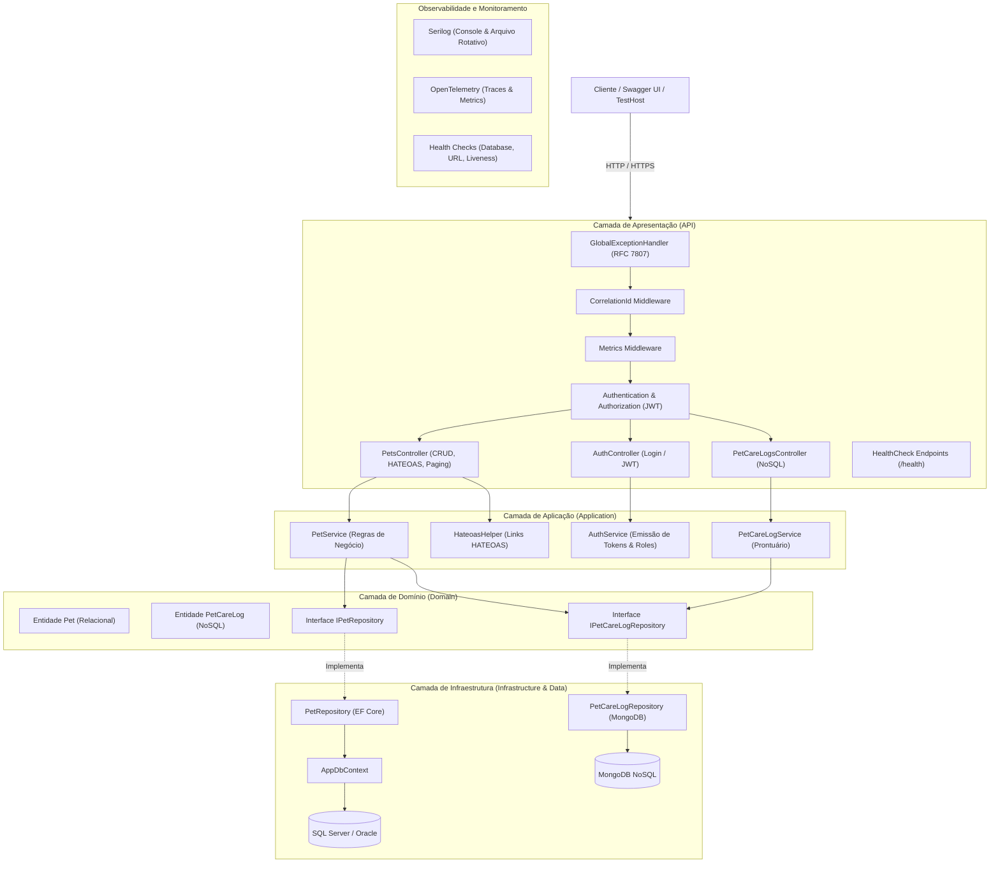

# FIAP - ADVANCED BUSINESS DEVELOPMENT WITH .NET
## ENTREGA FINAL - 4ª SPRINT (PetHealthEcosystem API)

API ASP.NET Core desenvolvida para o ecossistema de saúde animal (**PetHealthEcosystem**), contemplando a consolidação completa de todas as sprints: arquitetura limpa em camadas, API RESTful com HATEOAS, paginação, ordenação e filtros dinâmicos, autenticação e autorização com JWT (RBAC), persistência relacional com Entity Framework Core (Migrações aplicadas) e persistência NoSQL com MongoDB, observabilidade completa (Health Checks, Serilog estruturado, OpenTelemetry) e suite rigorosa de testes automatizados (unitários e de integração) no padrão AAA (xUnit).

---

## 👥 Integrantes do Grupo (Turma: 2TDSPV)

| Nome Completo | RM | Turma |
| :--- | :--- | :--- |
| **Gabriel Costa Solano** | **562325** | 2TDSPV |
| **Leandro Guarido** | **561760** | 2TDSPV |
| **Kaiky Pereira Rodrigues** | **564578** | 2TDSPV |

---

## 🏛️ Arquitetura da Solução

O projeto segue os princípios de **Clean Architecture**, **SOLID** e **Clean Code**, garantindo separação estrita de responsabilidades, inversão de controle via Injeção de Dependência nativa e independência de frameworks externos.

### Diagrama de Arquitetura (Mermaid)



---

## 📋 Consolidação dos Requisitos da 4ª Sprint (100 pts)

### 1. Arquitetura e Código (30 pts)
- **Clean Architecture em camadas:**
  - `Domain`: Entidades centrais (`Pet`, `PetCareLog`) e contratos de repositório (`IPetRepository`, `IPetCareLogRepository`).
  - `Application`: Serviços orquestradores de regras de negócio (`PetService`, `AuthService`, `PetCareLogService`), DTOs e helpers HATEOAS.
  - `Infrastructure`: Implementações concretas de repositórios com EF Core e MongoDB Driver.
  - `API`: Controladores RESTful, Middlewares e configuração de DI.
- **SOLID & Clean Code:** Responsabilidade única, abstrações desacopladas, injeção de dependência via interfaces em toda a aplicação.
- **Tratamento Global de Exceções:** Implementado via `GlobalExceptionHandlerMiddleware`, capturando qualquer falha não tratada e respondendo com o padrão internacional **RFC 7807 (ProblemDetails)** com código HTTP adequado, mensagem de erro amigável, caminho e `CorrelationId` rastreável.

### 2. API Restful Completa (20 pts)
- **Documentação Swagger/OpenAPI:** Atualizada, descrevendo todas as rotas e tipos, além de botão `Authorize` para inserção do token JWT Bearer (`Bearer <token>`).
- **Paginação, Ordenação e Filtros:**
  - Endpoint `GET /api/pets?pageNumber=1&pageSize=10&sortBy=name&sortOrder=asc&breed=Golden&needsPostOpCare=true`
  - Metadados de paginação com cálculo de `totalPages`, `hasPrevious`, `hasNext` e `totalItems`.
- **HATEOAS nos Endpoints de Consulta:**
  - Recursos retornam links hipermídia autoexplicativos com método HTTP e relação (`self`, `update`, `delete`, `care-logs`, `all-pets`).
  - Respostas paginadas incluem links de navegação (`self`, `first`, `previous`, `next`, `last`).
- **Autenticação e Autorização (JWT / RBAC):**
  - Endpoint `POST /api/auth/login` gerando tokens assinados (HMAC-SHA256) com claims de usuário e roles.
  - Controle de acesso granular: endpoints de mutação (`POST`, `PUT`) exigem usuário autenticado (`[Authorize]`), enquanto a remoção (`DELETE`) exige privilégios de Administrador (`[Authorize(Roles = "Admin")]`).

### 3. Persistência de Dados Relacional e NoSQL (20 pts)
- **Entity Framework Core com Migrações:**
  - Configurado com migrações aplicadas (`InitialCreate`) gerenciando a tabela `PETS`.
  - Suporte a SQL Server (LocalDB / produção) e Oracle. Execução automática de migrações na inicialização do serviço.
- **MongoDB NoSQL Integrado:**
  - Documentos `PetCareLog` armazenados no MongoDB na coleção `PetCareLogs`.
  - Cada cadastro, atualização ou cuidado pós-operatório gera um registro imutável de prontuário e auditoria no MongoDB.
  - Repositório concreto `PetCareLogRepository` implementando `IPetCareLogRepository`.
- **Padrão Repository:** Total desacoplamento entre os serviços de aplicação e os mecanismos de banco de dados.

### 4. Monitoramento, Observabilidade e Testes (20 pts)
- **Health Checks Configuradas e Funcionais:**
  - `GET /health`: Health check abrangente com status da base de dados e conectividade externa.
  - `GET /health/ready`: Verificação de prontidão para receber requisições de balanceadores.
  - `GET /health/live`: Liveness check para orquestradores como Kubernetes.
- **Logging Estruturado (Serilog):**
  - Logs detalhados no console e em arquivos rotativos diários (`logs/log-YYYYMMDD.txt`).
  - Enriquecimento com MachineName, Environment e rastreamento com `CorrelationId` em todas as camadas.
- **OpenTelemetry:**
  - Rastreamento distribuído de requisições HTTP, ASP.NET Core e Entity Framework Core.
  - Métricas de requisições e latência (`PetMetrics`).
- **Testes Automatizados (xUnit + Moq):**
  - Padrão **AAA (Arrange, Act, Assert)** e convenção `Metodo_Cenario_Resultado`.
  - **37 testes automatizados aprovados (100% de sucesso)** cobrindo camadas de Domínio, Aplicação e API:
    - **22 Testes Unitários** (`PetHealthEcosystem.Tests.Unit`): validando regras de domínio, validação de campos, cálculo de paginação, serviços de autenticação e prontuário NoSQL.
    - **15 Testes de Integração** (`PetHealthEcosystem.Tests.Integration`): subindo TestHost completo via `WebApplicationFactory` testando fluxos HTTP ponta a ponta, headers `Location`, HATEOAS, paginação, login JWT e health checks.

---

## 🔑 Credenciais de Teste para Autenticação JWT

Para testar a autenticação na API ou via Swagger UI, utilize os usuários pré-configurados:

| Usuário | Senha | Perfil (Role) | Permissões |
| :--- | :--- | :--- | :--- |
| `admin` | `Admin@123` | **Admin** | Acesso total (Leitura, Criação, Edição e Exclusão) |
| `veterinario` | `Vet@123` | **Veterinario** | Leitura, Criação, Atualização e Registros de Cuidados |
| `tutor` | `Tutor@123` | **Tutor** | Leitura e consulta de pets |

---

## 📡 Catálogo de Endpoints

### 🔐 Autenticação
| Método | Endpoint | Proteção | Descrição |
| :--- | :--- | :--- | :--- |
| `POST` | `/api/auth/login` | Público | Autentica e retorna token JWT com claims e role |

### 🐾 Pets (Relacional - EF Core)
| Método | Endpoint | Proteção | Descrição |
| :--- | :--- | :--- | :--- |
| `GET` | `/api/pets` | Público | Consulta paginada com ordenação, filtros e HATEOAS |
| `GET` | `/api/pets/{id}` | Público | Detalhes do pet por Id com links HATEOAS |
| `GET` | `/api/pets/breed/{breed}` | Público | Filtra pets por raça |
| `GET` | `/api/pets/post-op/{needsCare}` | Público | Filtra por necessidade de pós-operatório |
| `GET` | `/api/pets/tutor/{tutorName}` | Público | Filtra pets por tutor |
| `POST` | `/api/pets` | `[Authorize]` | Cadastra pet e registra histórico no MongoDB |
| `PUT` | `/api/pets/{id}` | `[Authorize]` | Atualiza pet e registra alteração no MongoDB |
| `DELETE` | `/api/pets/{id}` | `[Authorize(Roles="Admin")]` | Exclui pet do sistema (somente Admin) |

### 📝 Prontuário e Auditoria (NoSQL - MongoDB)
| Método | Endpoint | Proteção | Descrição |
| :--- | :--- | :--- | :--- |
| `GET` | `/api/petcarelogs` | Público | Lista todos os logs clínicos do MongoDB |
| `GET` | `/api/petcarelogs/pet/{petId}` | Público | Retorna histórico clínico NoSQL de um pet |
| `GET` | `/api/petcarelogs/{id}` | Público | Busca registro clínico por Id (ObjectId) |
| `POST` | `/api/petcarelogs` | `[Authorize]` | Registra novo cuidado/evento clínico no MongoDB |

### 🩺 Observabilidade & Health Checks
| Método | Endpoint | Descrição |
| :--- | :--- | :--- |
| `GET` | `/health` | Status de integridade completo (Banco, serviços externos) |
| `GET` | `/health/ready` | Check de prontidão (Readiness) |
| `GET` | `/health/live` | Check de vida da aplicação (Liveness) |

---

## 🚀 Como Executar o Projeto

### Pré-requisitos
- [.NET SDK 10 / 8](https://dotnet.microsoft.com/download)
- Instância do SQL Server (LocalDB `(localdb)\mssqllocaldb` ou SQL Server standard)
- (Opcional) Instância local do MongoDB na porta `27017` (a API possui fallback em memória automático se o MongoDB não estiver rodando no host)

### 1. Restaurar dependências
```bash
dotnet restore
```

### 2. Executar migrações do EF Core
```bash
dotnet ef database update --project src/PetHealthEcosystem.Api
```

### 3. Rodar a API
```bash
dotnet run --project src/PetHealthEcosystem.Api
```
Acesse o Swagger interativo em:
👉 `https://localhost:5001/swagger` ou `http://localhost:5080/swagger`

---

## 🧪 Como Executar os Testes Automatizados

Para executar todos os **37 testes automatizados** com relatório de execução:

```bash
dotnet test
```

Para rodar projetos específicos:
```bash
# Testes Unitários (22 testes)
dotnet test tests/PetHealthEcosystem.Tests.Unit

# Testes de Integração (15 testes)
dotnet test tests/PetHealthEcosystem.Tests.Integration
```
