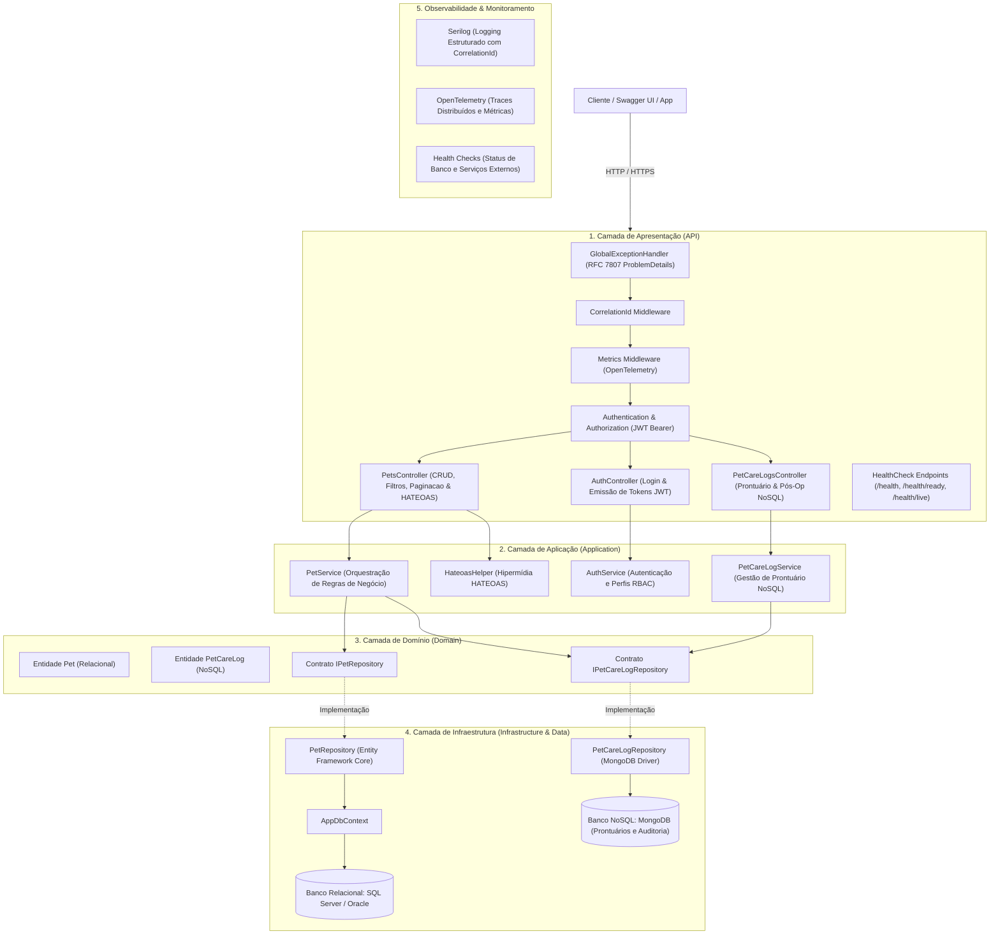

# 🐾 PetHealth — Ecossistema de Saúde Animal Proativa

> **Plataforma de Saúde Animal focada nos Pilares Preventivo e Terapêutico**, conectando tutores e clínicas veterinárias através de acompanhamento contínuo, monitoramento pós-operatório estruturado e histórico clínico integrado.

---

## 👥 Integrantes da Equipe

| Nome Completo | RM | Turma |
| :--- | :--- | :--- |
| **Gabriel Costa Solano** | **562325** | 2TDSPV |
| **Leandro Guarido** | **561760** | 2TDSPV |
| **Kaiky Pereira Rodrigues** | **564578** | 2TDSPV |

---

## 🎯 Visão Geral & Pitch do Projeto

### O Problema a Resolver
O mercado de cuidados veterinários sofre de **extrema reatividade**: tutores geralmente buscam a clínica veterinária apenas em situações de emergência, dor evidente ou para a aplicação de vacinas obrigatórias nos primeiros meses. Esse padrão gera:
1. **Redução na saúde longitudinal e longevidade do animal**, pela ausência de acompanhamento preventivo e check-ups rotineiros.
2. **Abandono do acompanhamento pós-operatório**, elevando o risco de complicações clínicas e reinternações emergenciais de alto custo.
3. **Baixa previsibilidade e perda de retenção/LTV (Lifetime Value)** para as clínicas veterinárias parceiras.

### A Solução PetHealth
A **PetHealth** é um ecossistema inteligente estruturado em dois grandes pilares:
- **Pilar Preventivo:** Lembretes proativos de vacinação e profilaxia, agendamento preventivo e acompanhamento contínuo da saúde do pet.
- **Pilar Terapêutico & Pós-Operatório:** Acompanhamento estruturado após cirurgias ou procedimentos clínicos, monitorando a evolução do animal e mantendo o tutor engajado no tratamento.

A plataforma integra o tutor (canal mobile e mensageria) a um backend robusto em ASP.NET Core e banco de dados poliglota (SQL Server e MongoDB).

---

## 🏛️ Arquitetura da Solução Backend

A API foi desenvolvida seguindo os princípios de **Clean Architecture**, **SOLID** e **Clean Code**, garantindo separação em camadas, testabilidade e baixo acoplamento.

### 📐 Diagrama de Arquitetura (Mermaid)



---

## 🛠️ Tecnologias e Recursos da Solução

### 1. Arquitetura e Código
- **Separação em Camadas:** `Domain` (entidades e contratos), `Application` (serviços e regras de negócio), `Infrastructure` (implementação de repositórios EF Core e MongoDB), `Data` e `Controllers`.
- **Injeção de Dependência:** Registro nativo no contêiner IoC do ASP.NET Core (`AddScoped`, `AddSingleton`).
- **Tratamento Global de Exceções:** Implementado via `GlobalExceptionHandlerMiddleware`, padronizando qualquer erro não tratado no formato **RFC 7807 (ProblemDetails)** com código HTTP apropriado e rastreamento por `CorrelationId`.

### 2. API RESTful Completa
- **Documentação Swagger/OpenAPI:** Atualizada, descrevendo todas as rotas e tipos, com suporte a inserção de token **JWT Bearer** no botão interativo *Authorize*.
- **Paginação, Ordenação e Filtros:** Implementados em `GET /api/pets`, aceitando `pageNumber`, `pageSize`, `sortBy`, `sortOrder`, `name`, `breed`, `tutorName` e `needsPostOpCare`, com metadados completos (`totalPages`, `totalItems`, `hasPrevious`, `hasNext`).
- **HATEOAS:** Respostas de consulta individuais e coleções são envelopadas com links navegáveis (`self`, `update`, `delete`, `care-logs`, `all-pets`, `first`, `previous`, `next`, `last`).
- **Autenticação e Autorização (JWT / RBAC):** `POST /api/auth/login` gerando tokens assinados via HMAC-SHA256 com claims de usuário e roles. Endpoints de mutação exigem autenticação (`[Authorize]`), e deleção exige perfil de Administrador (`[Authorize(Roles = "Admin")]`).

### 3. Persistência de Dados Poliglota (Relacional + NoSQL)
- **Entity Framework Core com Migrações:** Migração inicial `InitialCreate` gerenciando a tabela `PETS` no SQL Server (ou Oracle), com auto-migração na inicialização.
- **MongoDB NoSQL Integrado:** Armazenamento de prontuários clínicos e histórico de cuidados (`PetCareLog` na coleção `PetCareLogs`), gerando registros no MongoDB a cada alteração cadastral ou clínica.
- **Padrão Repository:** Total desacoplamento entre serviços de aplicação e os bancos de dados (`PetRepository` e `PetCareLogRepository`).

### 4. Monitoramento e Observabilidade
- **Health Checks:**
  - `GET /health`: Diagnóstico completo de integridade (banco de dados e serviços externos).
  - `GET /health/ready`: Verificação de prontidão para tráfego (Readiness).
  - `GET /health/live`: Liveness check para orquestradores de contêineres.
- **Logging Estruturado (Serilog):** Saída simultânea para console e arquivos diários rotativos (`logs/log-*.txt`), enriquecidos com `CorrelationId` e MachineName.
- **OpenTelemetry:** Traces distribuídos (ASP.NET Core, chamadas HTTP e EF Core) e métricas customizadas de latência e requisições (`PetMetrics`).

---

## 🔑 Credenciais de Teste para Autenticação JWT

Para testar a autenticação na API ou via Swagger UI:

| Usuário | Senha | Perfil (Role) | Permissões |
| :--- | :--- | :--- | :--- |
| `admin` | `Admin@123` | **Admin** | Acesso total (Leitura, Cadastro, Atualização e Exclusão) |
| `veterinario` | `Vet@123` | **Veterinario** | Leitura, Cadastro, Atualização e Prontuário |
| `tutor` | `Tutor@123` | **Tutor** | Leitura e consulta de dados de pets |

---

## 📡 Catálogo de Endpoints da API

### 🔐 Autenticação
| Método | Endpoint | Acesso | Descrição |
| :--- | :--- | :--- | :--- |
| `POST` | `/api/auth/login` | Público | Autentica usuário e retorna token JWT assinado |

### 🐶 Gestão de Pets (Relacional - EF Core)
| Método | Endpoint | Acesso | Descrição |
| :--- | :--- | :--- | :--- |
| `GET` | `/api/pets` | Público | Lista paginada com ordenação, filtros e links HATEOAS |
| `GET` | `/api/pets/{id}` | Público | Detalhes do pet com links de navegação HATEOAS |
| `GET` | `/api/pets/breed/{breed}` | Público | Consulta pets filtrados por raça |
| `GET` | `/api/pets/post-op/{needsCare}` | Público | Filtra pets com necessidade de cuidado pós-operatório |
| `GET` | `/api/pets/tutor/{tutorName}` | Público | Consulta pets pelo nome do tutor |
| `POST` | `/api/pets` | `[Authorize]` | Cadastra novo pet e registra histórico no MongoDB |
| `PUT` | `/api/pets/{id}` | `[Authorize]` | Atualiza pet e registra alteração no prontuário NoSQL |
| `DELETE` | `/api/pets/{id}` | `[Authorize(Roles="Admin")]` | Remove pet da base (restrito a Admin) |

### 📋 Prontuário Clínico & Auditoria (NoSQL - MongoDB)
| Método | Endpoint | Acesso | Descrição |
| :--- | :--- | :--- | :--- |
| `GET` | `/api/petcarelogs` | Público | Retorna todos os registros de cuidados e prontuários |
| `GET` | `/api/petcarelogs/pet/{petId}` | Público | Histórico clínico e cuidados registrados para o pet |
| `GET` | `/api/petcarelogs/{id}` | Público | Busca registro clínico por Id (ObjectId) |
| `POST` | `/api/petcarelogs` | `[Authorize]` | Registra novo cuidado, medicação ou observação clínica |

### 🩺 Integridade & Observabilidade
| Método | Endpoint | Descrição |
| :--- | :--- | :--- |
| `GET` | `/health` | Relatório completo de integridade da aplicação e dependências |
| `GET` | `/health/ready` | Verificação de prontidão para tráfego (Readiness) |
| `GET` | `/health/live` | Verificação de disponibilidade da aplicação (Liveness) |

---

## 🧪 Testes Automatizados (Padrão AAA com xUnit)

O projeto conta com **37 testes automatizados (100% aprovados)** cobrindo as camadas de Domínio, Aplicação e Apresentação, seguindo o padrão **Arrange-Act-Assert**:

* **22 Testes Unitários (`PetHealthEcosystem.Tests.Unit`):**
  - **`PetServiceTests` (13 testes):** Validações cadastrais de negócio (nome obrigatório, idade não-negativa, tutor obrigatório), atualização, exclusão, paginação dinâmica e registro de log no MongoDB via Moq.
  - **`AuthServiceTests` (6 testes):** Emissão de tokens JWT, claims de usuário/role para Admin e Veterinário, recusa de senhas inválidas e credenciais vazias.
  - **`PetCareLogServiceTests` (3 testes):** Validação de persistência e consulta no repositório NoSQL.
* **15 Testes de Integração (`PetHealthEcosystem.Tests.Integration`):**
  - **`PetsControllerIntegrationTests` (8 testes):** Ciclo HTTP real com `WebApplicationFactory` e banco InMemory, validando `201 Created` com header `Location`, `400 BadRequest`, `404 NotFound`, atualização, exclusão e o endpoint `/health`.
  - **`AuthControllerIntegrationTests` (2 testes):** Autenticação ponta a ponta com token JWT e validação de `401 Unauthorized`.
  - **`PetCareLogsControllerIntegrationTests` (3 testes):** Endpoints NoSQL de cadastro e consulta de logs clínicos.
  - **`PetsPaginationHateoasIntegrationTests` (2 testes):** Validação dos metadados de paginação e links HATEOAS (`self`, `first`, `previous`, `next`, `last`).

### Como Executar os Testes:
```bash
# Executa todos os testes da solução
dotnet test

# Executa apenas os testes unitários
dotnet test tests/PetHealthEcosystem.Tests.Unit

# Executa apenas os testes de integração
dotnet test tests/PetHealthEcosystem.Tests.Integration
```

---

## 🚀 Como Executar o Projeto Localmente

### Pré-requisitos
- [.NET SDK 10 ou superior](https://dotnet.microsoft.com/download)
- SQL Server (LocalDB `(localdb)\mssqllocaldb` ativo por padrão no Windows)
- (Opcional) MongoDB local na porta `27017` (a aplicação possui contingência em memória automática caso o MongoDB não esteja em execução)

### 1. Restaurar os pacotes
```bash
dotnet restore
```

### 2. Aplicar as migrações do banco relacional
```bash
dotnet ef database update --project src/PetHealthEcosystem.Api
```

### 3. Iniciar a API
```bash
dotnet run --project src/PetHealthEcosystem.Api
```

Acesse o **Swagger interativo** no navegador:
👉 `https://localhost:5001/swagger` ou `http://localhost:5080/swagger`
