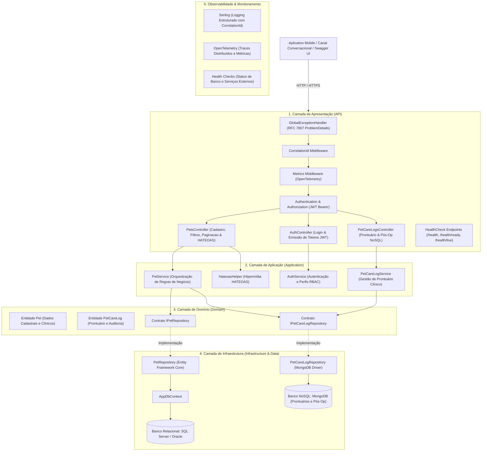

# 🐾 PetHealth — Ecossistema de Saúde Animal Proativa

> **Plataforma Omnichannel de Saúde Animal focada nos Pilares Preventivo e Terapêutico**, conectando tutores e clínicas veterinárias através de acompanhamento contínuo, triagem assistida e monitoramento pós-operatório inteligente.

---

## 👥 Equipe do Projeto

| Nome Completo | RM | Turma |
| :--- | :--- | :--- |
| **Gabriel Costa Solano** | **562325** | 2TDSPV |
| **Leandro Guarido** | **561760** | 2TDSPV |
| **Kaiky Pereira Rodrigues** | **564578** | 2TDSPV |

---

## 🎯 Pitch & Visão do Negócio

### O Problema a Resolver
O mercado pet enfrenta uma **extrema reatividade**: tutores geralmente buscam atendimento veterinário apenas em cenários de emergência, dor evidente ou nas primeiras doses vacinais. Esse comportamento reativo gera:
1. **Piora na saúde longitudinal e longevidade do pet**, pela ausência de medicina preventiva e check-ups rotineiros.
2. **Abandono do acompanhamento pós-operatório**, gerando complicações clínicas evitáveis, readmissões de emergência complexas e custos elevados ao tutor.
3. **Baixa previsibilidade e perda de LTV (Lifetime Value)** para as clínicas veterinárias parceiras devido à baixa taxa de retorno espontâneo em 90 dias.

### A Solução PetHealth
A **PetHealth** é um ecossistema inteligente estruturado em dois grandes pilares:
- **Pilar Preventivo:** Lembretes de vacinação hiper-personalizados (adaptados a raça, idade, porte e histórico), agendamento preditivo de consultas preventivas e acompanhamento profilático.
- **Pilar Terapêutico & Pós-Operatório:** Check-ins automatizados e contextualizados após procedimentos cirúrgicos ou consultas, monitorando ingestão de água, apetite, medicação e cicatrização.

A plataforma integra canais sem fricção (WhatsApp com IA Conversacional e Aplicativo Mobile dedicado ao tutor) ao backend robusto e painel de gestão para médicos veterinários.

---

## 🏛️ Arquitetura da Solução Backend

A API do PetHealth foi projetada seguindo rigorosamente os princípios de **Clean Architecture**, **SOLID** e **Clean Code**, garantindo alto desacoplamento, testabilidade e independência de tecnologias externas.

### 📐 Diagrama de Arquitetura (Mermaid)



---

## 🛠️ Tecnologias e Funcionalidades Implementadas

### 1. Camadas e Padrões Arquiteturais
- **Domain:** Modelos de dados centrais (`Pet`, `PetCareLog`) e interfaces de repositório (`IPetRepository`, `IPetCareLogRepository`), sem acoplamento a bibliotecas de infraestrutura.
- **Application:** Serviços com regras de validação (ex: nome obrigatório, idade não-negativa, tutor obrigatório), paginação, DTOs de autenticação e construção de hipermídia (HATEOAS).
- **Infrastructure:** Implementações concretas de repositórios isoladas via Dependency Injection.
- **Tratamento Global de Erros:** Middleware `GlobalExceptionHandlerMiddleware` padronizando respostas de erro em conformidade com **RFC 7807 (ProblemDetails)**, rastreando falhas por `CorrelationId`.

### 2. Persistência Poliglota (Relacional + NoSQL)
- **Relacional (EF Core com Migrations):** Gestão dos dados cadastrais dos pets e tutores (`PETS`), com mapeamento fluente, suporte a SQL Server / Oracle e auto-migração na inicialização.
- **NoSQL (MongoDB):** Armazenamento de prontuários clínicos, check-ins de acompanhamento pós-operatório e logs de auditoria imutáveis (`PetCareLog` na coleção `PetCareLogs`).
- **Resiliência:** Repositório NoSQL em memória de contingência para execução de testes de integração e cenários sem instância física do MongoDB ativa.

### 3. API RESTful com HATEOAS, Paginação e Filtros
- **HATEOAS:** Respostas de consulta individuais e coleções são envelopadas com links autoexplicativos (`self`, `update`, `delete`, `care-logs`, `all-pets`).
- **Paginação e Filtros Dinâmicos:** `GET /api/pets` aceita filtros combinados (`name`, `breed`, `tutorName`, `needsPostOpCare`), paginação (`pageNumber`, `pageSize`) e ordenação customizável (`sortBy`, `sortOrder`).
- **Documentação OpenAPI / Swagger:** Interface gráfica interativa documentando modelos e rotas com suporte a autenticação Bearer.

### 4. Segurança e Autorização (JWT / RBAC)
- Emissão de tokens JWT assinados via HMAC-SHA256 (`POST /api/auth/login`).
- **Controle de Acesso Baseado em Perfis (RBAC):**
  - **Admin:** Controle irrestrito (leitura, cadastro, atualização e exclusão).
  - **Veterinario:** Acesso a consultas, cadastro de pets, atualização e inclusão de registros no prontuário NoSQL.
  - **Tutor:** Acesso para consulta de seus respectivos animais e orientações.

### 5. Monitoramento e Observabilidade
- **Health Checks:**
  - `GET /health`: Diagnóstico completo de integridade (bancos de dados e serviços externos).
  - `GET /health/ready`: Verificação de prontidão para balanceadores de carga.
  - `GET /health/live`: Liveness check para orquestradores de contêineres.
- **Serilog:** Logs estruturados em console e arquivos rotativos diários (`logs/log-*.txt`), enriquecidos com `CorrelationId` gerado por requisição.
- **OpenTelemetry:** Instrumentação automática para ASP.NET Core, chamadas HTTP e EF Core, com métricas de requisições e latência (`PetMetrics`).

---

## 🔑 Credenciais de Teste (JWT)

A API possui usuários pré-configurados para validação das permissões e fluxos:

| Usuário | Senha | Perfil (Role) | Permissões |
| :--- | :--- | :--- | :--- |
| `admin` | `Admin@123` | **Admin** | Permissão total (CRUD completo + Exclusão de Pets) |
| `veterinario` | `Vet@123` | **Veterinario** | Criação, Edição, Consultas e Inserção em Prontuário NoSQL |
| `tutor` | `Tutor@123` | **Tutor** | Leitura e consulta de dados |

---

## 📡 Catálogo de Endpoints

### 🔐 Autenticação
| Método | Endpoint | Acesso | Descrição |
| :--- | :--- | :--- | :--- |
| `POST` | `/api/auth/login` | Público | Autentica usuário e retorna token JWT assinado |

### 🐶 Gestão de Pets (Relacional - EF Core)
| Método | Endpoint | Acesso | Descrição |
| :--- | :--- | :--- | :--- |
| `GET` | `/api/pets` | Público | Lista paginada com ordenação, filtros e links HATEOAS |
| `GET` | `/api/pets/{id}` | Público | Detalhes do pet com links de navegação HATEOAS |
| `GET` | `/api/pets/breed/{breed}` | Público | Consulta pets filtrados por raça |
| `GET` | `/api/pets/post-op/{needsCare}` | Público | Filtra pets com necessidade de cuidado pós-operatório |
| `GET` | `/api/pets/post-op/critical-alerts` | `[Authorize(Roles="Admin,Veterinario")]` | Painel de triagem: lista pets com alertas pós-op críticos |
| `GET` | `/api/pets/{id}/medical-record` | Público | Prontuário consolidado (cadastro, vacinas e check-ins) |
| `GET` | `/api/pets/tutor/{tutorName}` | Público | Consulta pets pelo nome do tutor |
| `POST` | `/api/pets` | `[Authorize]` | Cadastra novo pet e registra histórico no MongoDB |
| `POST` | `/api/pets/{id}/post-op-checkin` | Público | Registra check-in pós-op (WhatsApp/App) e avalia criticidade |
| `POST` | `/api/pets/{id}/vaccines` | `[Authorize(Roles="Admin,Veterinario")]` | Registra vacina e agenda reforço na carteira digital |
| `PUT` | `/api/pets/{id}` | `[Authorize]` | Atualiza pet e registra alteração no prontuário NoSQL |
| `DELETE` | `/api/pets/{id}` | `[Authorize(Roles="Admin")]` | Remove pet da base (restrito a Admin) |

### 📋 Prontuário Clínico & Acompanhamento Pós-Op (NoSQL - MongoDB)
| Método | Endpoint | Acesso | Descrição |
| :--- | :--- | :--- | :--- |
| `GET` | `/api/petcarelogs` | Público | Retorna todos os registros de cuidados e prontuários |
| `GET` | `/api/petcarelogs/pet/{petId}` | Público | Histórico clínico e check-ins pós-operatórios do pet |
| `GET` | `/api/petcarelogs/{id}` | Público | Busca registro clínico por Id (ObjectId) |
| `POST` | `/api/petcarelogs` | `[Authorize]` | Registra novo cuidado, medicação ou check-in pós-op |

### 🩺 Integridade & Observabilidade
| Método | Endpoint | Descrição |
| :--- | :--- | :--- |
| `GET` | `/health` | Relatório completo de saúde da aplicação e integrações |
| `GET` | `/health/ready` | Verificação de prontidão para tráfego (Readiness) |
| `GET` | `/health/live` | Verificação de disponibilidade da aplicação (Liveness) |

---

## 🧪 Estratégia de QA e Automação de Testes (Trabalho Contínuo com QA)

A plataforma PetHealth foi desenhada com **arquitetura orientada à testabilidade (QA Readiness)** para viabilizar a criação rápida e confiável de novos testes automatizados:

- **Guia Completo de Automação de QA:** Acesse a especificação completa em [docs/QA_AUTOMATION_GUIDE.md](docs/QA_AUTOMATION_GUIDE.md).
- **Especificações Formais em BDD / Gherkin:** Cenários estruturados em *Given-When-Then* para validação do pós-operatório inteligente, cálculo vacinal e segurança RBAC.
- **Padrão Object Mother & Test Data Builders:**
  - `PetTestDataBuilder`: Criação fluente de pets em cenários normais, pós-operatório ou alerta crítico.
  - `PostOpCheckInBuilder`: Montagem de respostas simuladas do canal WhatsApp (recuperação saudável vs intercorrências cirúrgicas).
  - `PetCareLogTestDataBuilder`: Instanciação de prontuários clínicos e vacinas NoSQL.
- **Utilitário de Autenticação para QA (`QaAuthTokenHelper`):** Geração instantânea de tokens JWT Bearer válidos para perfis `Admin`, `Veterinario` e `Tutor` sem overhead de chamadas HTTP de login nas suítes automatizadas.
- **Rastreabilidade de Diagnóstico:** Header `X-Correlation-Id` e especificação RFC 7807 (`ProblemDetails`) em todos os endpoints para investigação imediata de falhas de asserção em testes de QA.

### Suíte de Testes Existente (44 Testes 100% Aprovados):
* **26 Testes Unitários (`PetHealthEcosystem.Tests.Unit`):**
  - Regras clínicas de pós-operatório (detecção automática de dor severa, vômitos e sangramento).
  - Cálculo preventivo de datas de reforço vacinal.
  - Consistência cadastral, validações de domínio e paginação/ordenação.
  - Serviços de autenticação JWT e prontuário NoSQL.
* **18 Testes de Integração (`PetHealthEcosystem.Tests.Integration`):**
  - Simulação de check-ins via canal WhatsApp atualizando status no banco de dados.
  - Validação de rotas protegidas por perfil RBAC (Admin vs Veterinário vs Tutor).
  - Consulta do prontuário médico unificado e painel de alertas críticos.
  - Verificação de links hipermídia HATEOAS, paginação dinâmica e Health Checks.

### Como Executar os Testes:
```bash
# Executa todos os 44 testes da solução
dotnet test

# Executa apenas os testes unitários
dotnet test tests/PetHealthEcosystem.Tests.Unit

# Executa apenas os testes de integração
dotnet test tests/PetHealthEcosystem.Tests.Integration
```

---

## 🚀 Como Executar o Projeto Localmente

### Pré-requisitos
- [.NET SDK 10 ou superior](https://dotnet.microsoft.com/download)
- SQL Server (LocalDB `(localdb)\mssqllocaldb` já ativo por padrão no Windows)
- MongoDB (opcional; a API possui contingência automática para execução em desenvolvimento)

### 1. Restaurar os pacotes
```bash
dotnet restore
```

### 2. Aplicar as migrações do banco relacional
```bash
dotnet ef database update --project src/PetHealthEcosystem.Api
```

### 3. Iniciar a API
```bash
dotnet run --project src/PetHealthEcosystem.Api
```

Acesse o **Swagger interativo** no navegador:
👉 `https://localhost:5001/swagger` ou `http://localhost:5080/swagger`
